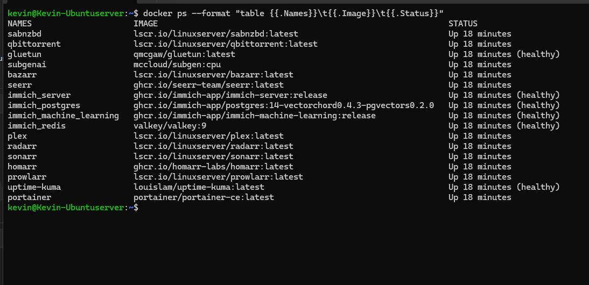

# Proxmox Homelab Infrastructure

## Project Overview

Designed, deployed, and maintained a virtualized home server environment to gain hands-on experience with Linux administration, virtualization, networking, containerization, and troubleshooting.

The environment uses Proxmox VE to host virtual machines, Ubuntu Server to run containerized services, and network-attached storage for centralized data management.

## Hardware & Infrastructure

| Component | Configuration |
|---|---|
| Server | Dell OptiPlex 7060 |
| Processor | Intel Core i5-8500 |
| Memory | 32 GB RAM |
| Storage | 1 TB SSD |
| Hypervisor | Proxmox VE |
| Virtual Machine | Ubuntu Server |
| Network Switch | Netgear GS308 |
| Network Storage | TerraMaster NAS |

## Technologies Used

- **Virtualization:** Proxmox VE, KVM
- **Operating Systems:** Ubuntu Server, Linux
- **Containerization:** Docker, Docker Compose
- **Networking:** TCP/IP, DNS, SMB/CIFS, network troubleshooting
- **Storage:** Network-attached storage, Linux filesystem mounts
- **Monitoring:** Uptime Kuma
- **Administration:** SSH, Linux command-line tools

## Docker Container Infrastructure

Deployed and administered 17 Docker containers within an Ubuntu Server virtual machine hosted on Proxmox VE.

### Technologies and Services
- **Container Management:** Docker, Portainer
- **Monitoring:** Uptime Kuma
- **Networking:** Gluetun VPN container
- **Application Hosting:** Plex, Immich, Seerr, Homarr
- **Data Services:** PostgreSQL, Redis
- **Automation:** Sonarr, Radarr, Prowlarr, Bazarr

### Administration and Troubleshooting
- Monitored container status and health using Docker CLI commands.
- Troubleshot application connectivity, VPN configuration, and container startup issues.
- Managed persistent storage and network-mounted volumes for containerized applications.
- Investigated application failures using container logs and Linux troubleshooting utilities.

### Docker Environment Screenshot

## Implementation

### 1. Virtualization

- Installed and configured Proxmox VE on a dedicated physical server.
- Created an Ubuntu Server virtual machine to host Linux-based applications.
- Configured virtual networking to allow communication between the VM and local network devices.

### 2. Network Storage Integration

- Integrated TerraMaster NAS storage with Ubuntu Server.
- Configured SMB/CIFS mounts to provide centralized storage.
- Managed filesystem permissions and container volume mappings.

### 3. Containerized Services

- Deployed Docker-based services for application hosting, monitoring, and media management.
- Configured persistent storage and network connectivity between services.
- Used container logs and Linux commands to diagnose application issues.

### 4. Troubleshooting

Investigated and resolved infrastructure issues including:

- NAS mount failures and storage connectivity problems.
- Docker container health-check failures.
- Linux filesystem capacity limitations.
- Application connectivity and service availability issues.

## Skills Demonstrated

- Linux server administration
- Virtual machine deployment and management
- Network troubleshooting
- Container deployment and maintenance
- Network storage configuration
- Technical problem-solving and documentation

## Future Improvements

- Expand Windows Server and Active Directory lab
- Implement centralized logging and monitoring
- Improve automated service recovery
- Create infrastructure architecture diagrams
- Document troubleshooting procedures and recovery processes
